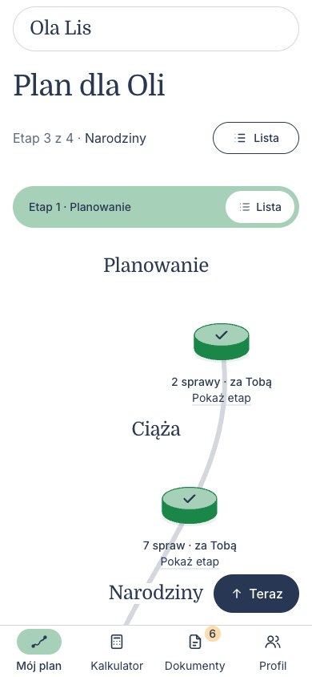
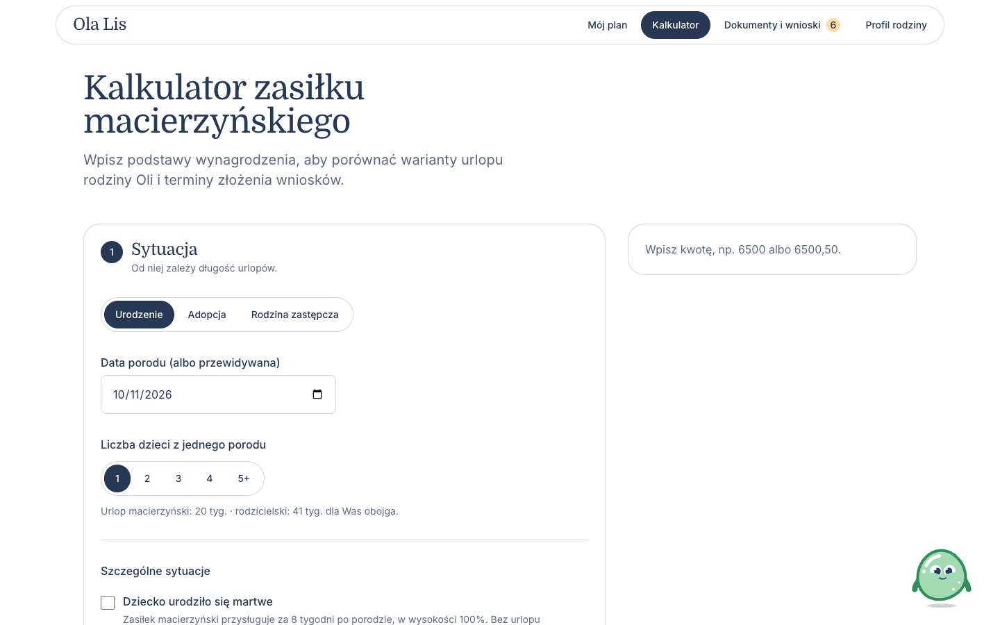
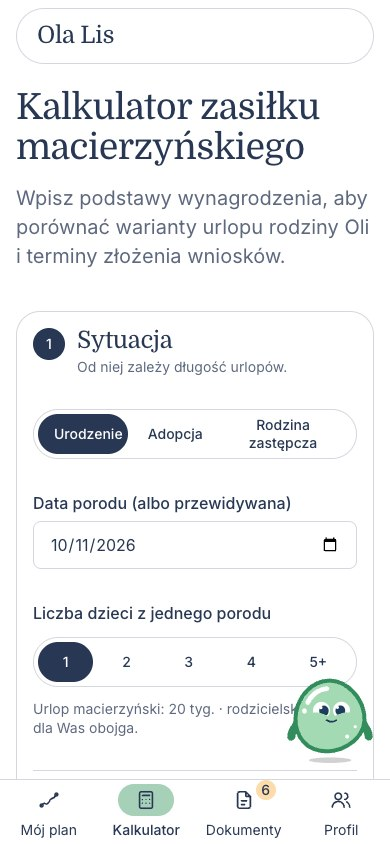
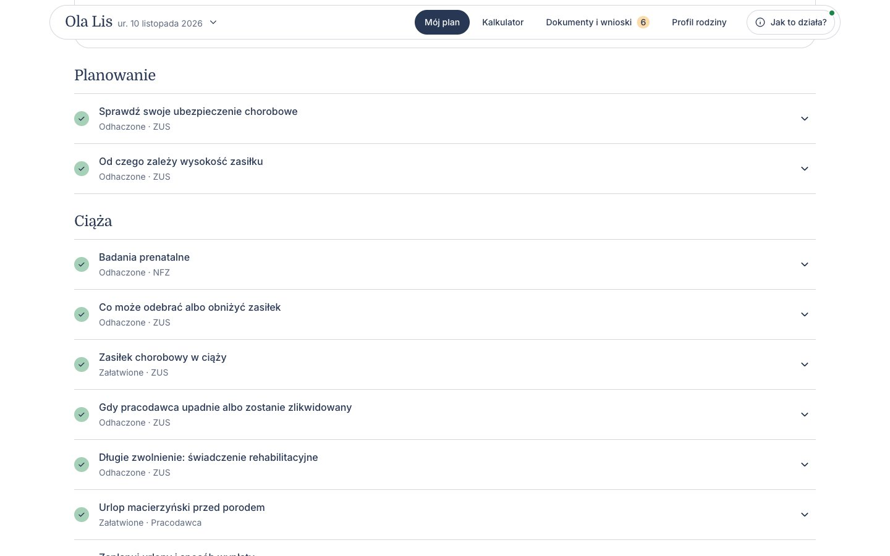
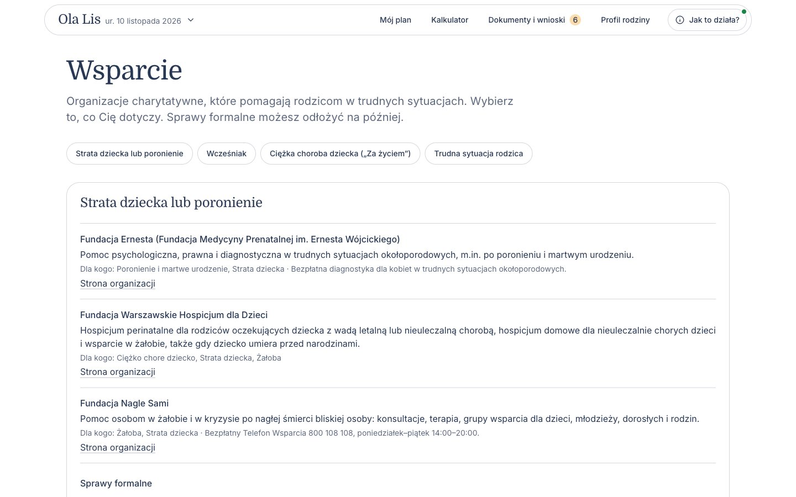
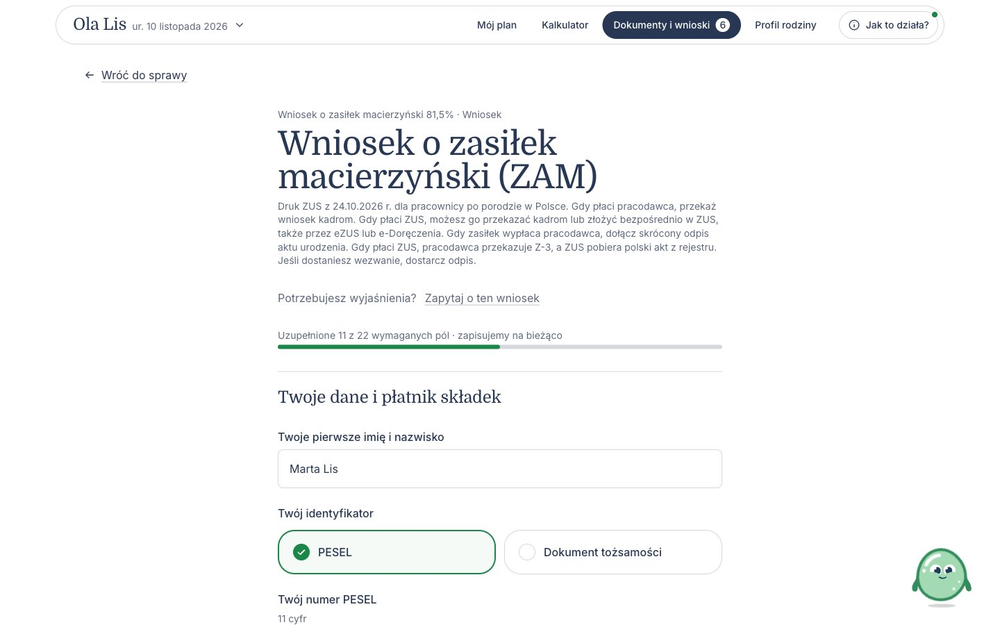
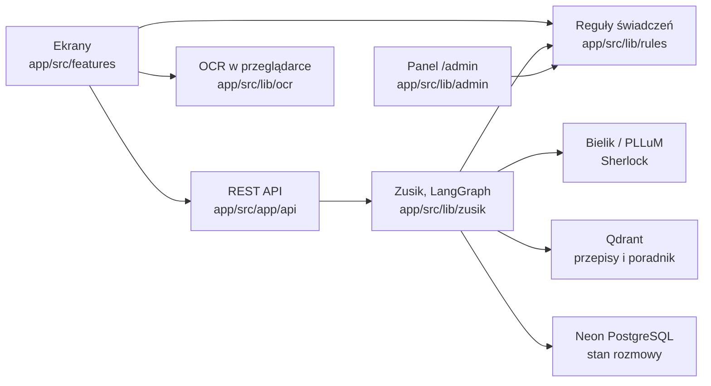

<picture>
  <source media="(prefers-color-scheme: dark)" srcset="app/public/logo/przewodnik-rodzica-biale.svg">
  
</picture>

# Zusik · Przewodnik Rodzica

Aplikacja webowa, w której rodzic sprawdza, jakie świadczenia rodzicielskie mu przysługują, liczy zasiłek dla obojga rodziców i przygotowuje wnioski do pracodawcy lub ZUS. Odpowiada na zadanie konkursowe ZUS na HackNation 2026.

**[Otwórz demo](https://straylight-hacknation.vercel.app)** · [Zrzuty ekranu](zgloszenie/)

| Komputer | Telefon |
|---|---|
|  |  |
|  |  |

Logowanie mObywatelem, pobranie danych rodziny z ZUS i przekazanie wniosku są symulacjami. Wyliczenia kwot, okresów i uprawnień robi prawdziwy kod reguł z testami.

Prezentacja i film pokazują główną ścieżkę rodzica. Czego w nich nie ma, opisujemy w sekcjach [Poza prezentacją i filmem](#poza-prezentacją-i-filmem), [Gotowość do wdrożenia](#gotowość-do-wdrożenia) i [Czego się nauczyliśmy](#czego-się-nauczyliśmy).

## Problem

Przyszły rodzic musi sam złożyć informacje z ustawy zasiłkowej, Kodeksu pracy, poradnika ZUS i stron gov.pl. Nie wie, czy ma ubezpieczenie chorobowe, ile dostanie przy wariancie 100% lub 81,5%, jak podzielić urlop z drugim rodzicem ani który wniosek składa się u pracodawcy, a który w ZUS. Błąd, np. przerwa w ubezpieczeniu w dniu porodu, wychodzi dopiero w decyzji odmownej.

## Co zbudowaliśmy

- **Plan rodziny.** Ścieżka od planowania dziecka przez ciążę i narodziny do kolejnych terminów. Przy każdej sprawie: co przygotować, komu złożyć, do kiedy.
- **Jeden kalkulator dla obojga rodziców.** Macierzyński, rodzicielski, ojcowski, wariant 100% lub 81,5%, liczba dzieci, adopcja i rodzina zastępcza, łączenie urlopu z pracą, wskazanie, kto wypłaca zasiłek.
- **Sprawdzenie ubezpieczenia na sprawach z zestawu ZUS.** Ekran `/sprawdz` rozstrzyga prawo do zasiłku regułami i pokazuje przepis, na którym oparto wynik. Można wybrać sprawę z zestawu albo wgrać PDF, który aplikacja odczytuje OCR w przeglądarce.
- **Wnioski.** 11 wzorów, w tym oficjalny ZAM, SR-2 i deklaracja POZ. Dla 9 z nich aplikacja generuje wypełniony PDF.
- **Zusik.** Asystent odpowiada na pytania z przypisami do przepisów i poradnika ZUS.
- **Wsparcie w trudnych sytuacjach.** Kontakty do fundacji pomagających po stracie dziecka, przy wcześniaku i ciężkiej chorobie dziecka.
- **Panel administratora.** Zmiana parametrów (stawki, wymiary urlopów, progi) ze sprawdzeniem na sprawach testowych i publikacją od wskazanej daty.

## Jak sprawdzić projekt

1. **Ubezpieczenie na sprawie z zestawu.** W demo wejdź w **Profil → Sprawdź sprawę z zestawu ZUS**. Wybierz jedną z 10 spraw (6 odmów, 4 przyznania) i porównaj wynik z decyzją ZUS. Możesz też użyć **Wgraj PDF sprawy**: odczyt 14–16 stron trwa ok. 25 s, potem aplikacja proponuje fakty ze wskazaniem strony, a Ty je potwierdzasz.
2. **Kalkulator.** W **Kalkulatorze** rozwiń **Sprawdź przykładową sprawę lub dokument PDF** i wybierz **Pracownica, 81,5% za cały okres**. Dla jednego dziecka urodzonego 3 czerwca 2026 r. i podstawy 5 608,85 zł stawka dzienna wynosi 152,37 zł, a za 28 dni czerwca 4 266,36 zł brutto. Zmień wariant wypłaty i porównaj miesiące.
3. **Wniosek.** Otwórz plan rodziny, wybierz sprawę na ścieżce, w zakładce **Dokumenty** otwórz wniosek, uzupełnij pola i sprawdź podgląd przed przekazaniem.
4. **Symulacje eZUS.** W **Profil → Konto eZUS** są podgląd e-ZLA, przykładowe zaświadczenie o zadłużeniu składkowym (0 zł lub 200 zł) oraz **Zwolnienia e-ZLA → Sprawdź ubezpieczenie na przykładzie** z [fikcyjnym pakietem dokumentów](app/public/demo/sickness/akta-demonstracyjne.pdf).
5. **Zusik.** W profilu wybierz **Otwórz rozmowę z Zusikiem**, zadaj pytanie o urlop lub dołącz fikcyjny PDF i porównaj przypisy ze źródłem.
6. **Panel administratora.** Wejdź na [`/admin`](https://straylight-hacknation.vercel.app/admin) (na czas konkursu logowanie jednym kliknięciem). W **Sprawy testowe** porównaj K-06 (odmowa, brak ubezpieczenia) i K-08 (brak informacji). Instrukcja zmiany parametru: [ZGLOSZENIE-PANEL-ADMINISTRACYJNY.md](ZGLOSZENIE-PANEL-ADMINISTRACYJNY.md).

## Poza prezentacją i filmem

### Plan zaczyna się przed ciążą

W pierwszych pytaniach rodzic może wybrać **Planujemy dziecko**. Ścieżka dostaje wtedy etap **Planowanie**: sprawdzenie ubezpieczenia chorobowego i tego, od czego zależy wysokość zasiłku. Zasiłek macierzyński przysługuje tylko wtedy, gdy w dniu porodu rodzic ma ubezpieczenie chorobowe. Przerwę w ubezpieczeniu łatwiej naprawić przed ciążą niż po decyzji odmownej.

Inspiracją były usługi publiczne Estonii i Australii, ułożone według zdarzeń życiowych. W Estonii usługa „narodziny dziecka” łączy sprawy od zgłoszenia ciąży po świadczenia rodzinne, a świadczenia rodzinne urząd proponuje rodzicom sam, bez wniosku ([OECD OPSI: usługa „narodziny dziecka”](https://oecd-opsi.org/innovations/child-life-event/), [OECD OPSI: świadczenia bez wniosku](https://oecd-opsi.org/innovations/proactive-family-benefits/)). Rządowe serwisy w Australii prowadzą rodzica już od etapu przed ciążą ([NSW Government: Before you are pregnant](https://www.nsw.gov.au/family-and-relationships/having-children/having-a-baby/before-you-are-pregnant), [myGov: Before your baby arrives](https://my.gov.au/en/services/raising-kids/having-a-baby/before-your-baby-arrives)).



W demo: **Mój plan → Lista**, sekcja **Planowanie**. Kod: `app/src/features/onboarding/flow.ts` (wybór „Planujemy dziecko”), `app/src/lib/plan/build.ts` (etap startowy planu), `app/src/lib/demo/fixtures.ts` (przystanki etapu).

### Wsparcie w trudnych sytuacjach

Zakładka **Wsparcie** (`/wsparcie`) jest dla rodziców po stracie dziecka lub poronieniu, z wcześniakiem, z ciężko chorym dzieckiem („Za życiem”) albo w trudnej sytuacji własnej. Najpierw pokazuje fundacje, które pomagają w danej sytuacji: czym się zajmują, co jest bezpłatne, telefon i stronę. Dopiero pod nimi są sprawy formalne ze źródłem w przepisach, np. uzupełniający urlop macierzyński przy wcześniaku albo dłuższy urlop rodzicielski z zaświadczeniem „Za życiem”. Strona jest celowo spokojna, bez animacji.

- Wpisy pochodzą wyłącznie ze stron samych organizacji i mają datę sprawdzenia. Wśród nich są m.in. Fundacja Ernesta, Fundacja Wcześniak Rodzice-Rodzicom, Fundacja Gajusz i Fundacja Nagle Sami.
- Administrator edytuje wpisy w panelu, a panel oznacza te sprawdzone ponad 183 dni temu.
- Do wsparcia prowadzą linki z planu, kart spraw, kalkulatora i pierwszych pytań. Stopka strony głównej wskazuje pomoc także bez logowania.



Kod: `app/src/features/support/`, `app/src/lib/support/organizations.ts`, `app/src/features/admin/support-editor.tsx`.

### PDF tylko tam, gdzie ma sens

Nie każdy wniosek da się pobrać jako PDF i to jest celowe. Tam, gdzie urząd przyjmuje wyłącznie formularz elektroniczny albo sam spisuje zgłoszenie, plik PDF tylko by mylił.

| Rodzaj | Wnioski | Co dostaje rodzic |
|---|---|---|
| Urzędowy druk | ZAM (zasiłek macierzyński), SR-2 (becikowe), deklaracja wyboru POZ | Wypełniony oryginalny druk. Pobranie działa dopiero po uzupełnieniu wymaganych pól |
| Pismo | Urlop macierzyński przed porodem, urlop ojcowski, urlop rodzicielski, łączenie urlopu z pracą, zgłoszenie dziecka do ubezpieczenia u pracodawcy, odpis aktu urodzenia | PDF pisma. Niepełne pismo ma znak „SZKIC” |
| Bez PDF | 800+ (SW-R) | Wniosek składa się tylko elektronicznie: eZUS, mZUS, bankowość elektroniczna albo Emp@tia. Aplikacja zbiera dane i wskazuje kanał |
| Bez PDF | Zgłoszenie urodzenia | Online przez gov.pl lub mObywatel albo w USC, gdzie kierownik urzędu przygotowuje protokół, a rodzic go podpisuje |

PDF powstaje w przeglądarce (pdf-lib). Rodzaj PDF dla każdego wniosku to pole `pdf` w `app/src/lib/demo/forms-*.ts`, a generowanie jest w `app/src/features/documents/pdf.ts` i `app/src/lib/forms/`.



## Stan funkcji

| Funkcja | Stan | Uwagi |
|---|---|---|
| Kalkulator, okresy i kwoty | Działa | 7 spraw z zestawu: 3 z kwotami zgodnymi z decyzjami co do grosza, 4 z okresami zgodnymi z pismami ZUS (testy) |
| `/sprawdz`, wybór sprawy z zestawu | Działa | Wynik zgodny z decyzją ZUS w 10 z 10 spraw |
| `/sprawdz`, wgranie PDF | Częściowo | OCR odczytuje rolę, okres, tytuł ubezpieczenia, zadłużenie. Daty z kratek i pismo odręczne często trzeba wpisać ręcznie |
| PDF → podstawa w kalkulatorze | Częściowo | Na skanach z zestawu kwota podstawy zwykle nie zostaje rozpoznana i wpisuje się ją ręcznie |
| Plan rodziny | Częściowo | Jedna rodzina demonstracyjna. Własne dane wpisuje się w kalkulatorze i na `/sprawdz` |
| Ostrzeżenia o ryzyku utraty świadczeń | Częściowo | Ogólny przystanek z ryzykami i odmowy na `/sprawdz`. Ostrzeżenia dopasowane do sytuacji rodziny nie są włączone |
| Wnioski i PDF | Działa | 11 wzorów, PDF dla 9. 800+ i zgłoszenie urodzenia bez PDF (tylko kanały elektroniczne) |
| Logowanie mObywatel, import danych, e-ZLA, zaświadczenie o zadłużeniu, przekazanie wniosku | Symulacja | Wygląd i przebieg bez połączenia z systemami państwowymi |
| Panel administratora | Działa w sesji | Zmiany obowiązują w sesji przeglądarki (podpisane ciasteczko). Wdrożenie wymaga trwałej bazy |
| Zusik | Działa, jakość zmienna | Odpowiedzi zależą od modelu i trafienia w korpus. Kwot model nie liczy |

## Gotowość do wdrożenia

Aplikacja działa produkcyjnie jako serwis demonstracyjny z automatyczną kontrolą jakości. Do wdrożenia w ZUS brakuje integracji z systemami państwowymi i trwałej bazy dla panelu administratora.

**Co już jest gotowe**

- **Produkcja z bramką jakości.** Każdy push przechodzi przez GitHub Actions: typy, lint i 705 testów. Jeśli któryś krok nie przejdzie, wdrożenie się nie zaczyna. Po wdrożeniu na produkcję workflow sprawdza asystenta na syntetycznych sprawach i kontroluje cytaty w odpowiedziach ([`.github/workflows/vercel-deploy.yml`](.github/workflows/vercel-deploy.yml)).
- **Obliczenia niezależne od AI.** Kalkulator, plan, `/sprawdz`, wnioski i OCR działają bez kluczy i bez modelu. Awaria usługi AI nie wyłącza obliczeń.
- **Zmiana przepisów bez nowej wersji.** Parametry mają datę obowiązywania i zmienia się je w panelu administratora.
- **Konfiguracja i sekrety.** Wszystko przez zmienne środowiskowe po stronie serwera. Brak zmiennej daje jawny błąd `config_missing`, a nie cichą awarię. Hasło administratora jest przechowywane jako skrót scrypt ([app/README.md](app/README.md)).
- **Dokumenty rodzica zostają u niego.** OCR działa w przeglądarce, a sprawy w aplikacji nie zawierają danych osobowych.
- **Wymagania techniczne zadania.** Next.js i React, REST API (11 tras w `app/src/app/api/`), widoki na komputer i telefon.

**Czego brakuje do wdrożenia w ZUS**

| Element | Dziś | Potrzebne |
|---|---|---|
| Logowanie, dane rodziny, e-ZLA, zaświadczenia | Symulacja | Integracja z login.gov.pl, mObywatelem i eZUS (PUE) |
| Przekazanie wniosku | Symulacja | Wysyłka do pracodawcy, ZUS i USC kanałami tych instytucji |
| Panel administratora | Zmiany w sesji przeglądarki | Trwała baza z historią wersji reguł i rolą zatwierdzającego |
| Ostrzeżenia o ryzyku utraty świadczeń | Ogólny przystanek z ryzykami | Ostrzeżenia dopasowane do sytuacji konkretnej rodziny |

## Wymagania zadania

| Wymaganie (treść zadania) | Gdzie |
|---|---|
| a. Zasiłek chorobowy w ciąży, świadczenie rehabilitacyjne, zasiłek w wysokości macierzyńskiego | Przystanki planu, `app/src/lib/rules/sickness.ts`, `case-maternity.ts`, `/sprawdz` |
| b. Kalkulator okresu i kwoty dla obojga rodziców, liczba dzieci | `app/src/features/calculator/`, `app/src/lib/rules/maternity.ts`, `rates.ts`, `paternity.ts` |
| c. Łączenie pracy z urlopem rodzicielskim | `app/src/lib/rules/parental-work.ts` |
| d. Oboje rodzice korzystają z uprawnień | Kalkulator: przejęcie, rodzicielski kolejno lub razem, 9 tygodni nieprzenoszalnych |
| e, j. Adopcja i niezawodowa rodzina zastępcza | Kalkulator i reguły `/sprawdz` (granice wieku) |
| f. Indywidualna podstawa i symulacja na sprawach z zestawu | `app/src/lib/plan/benefit-presets.ts`, testy w `app/tests/` |
| g. Dokumenty, terminy, płatnik albo ZUS | `app/src/lib/rules/payer.ts`, `app/src/features/documents/` |
| h. Ryzyka utraty lub obniżenia świadczeń | Częściowo, patrz tabela stanu |
| i. Organizacje wsparcia | `/wsparcie`, `app/src/lib/support/` |
| Symulacje: mObywatel, dane z ZUS, zadłużenie, e-ZLA, PUE/eZUS | `app/src/features/auth/`, `app/src/features/family/profile/` |
| Wnioski o urlopy, świadczenia i odpis aktu urodzenia | `app/src/lib/forms/`, `app/src/lib/demo/forms-civil.ts`, `app/public/forms/` |
| Linki do zus.pl, gov.pl, pip.gov.pl | Stopka strony głównej |
| Panel administracyjny do zmiany parametrów | `/admin`, `app/src/lib/admin/`, `app/src/lib/rules/parameters.ts` |
| Test jury: wybór lub upload wniosków PDF | `/sprawdz` i kalkulator |
| RWD, React/Next.js, REST API | Next.js 16, React 19, trasy w `app/src/app/api/` |

## Gdzie działa AI

| Funkcja | Mechanizm |
|---|---|
| Rozmowa z Zusikiem | Model językowy Bielik albo PLLuM (Sherlock, CloudFerro) przez Vercel AI SDK. Wyszukiwanie fragmentów przepisów i poradnika ZUS w Qdrant (`multilingual-e5-small`). Odpowiedź z przypisami |
| Prowadzenie sprawy w rozmowie | LangGraph.js zbiera brakujące fakty. Model pisze tekst, a kwoty, okresy i terminy liczy kod w `app/src/lib/rules` |
| Odczyt dokumentów | PDF.js czyta warstwę tekstową, Tesseract.js (polski model) rozpoznaje skany w przeglądarce. Rodzic potwierdza każdy odczytany fakt |
| Bez AI | Kalkulator, plan, terminy, `/sprawdz` i panel administratora. Wynik daje kod reguł |

**AI w pracy nad projektem.** Claude Code (Anthropic) i Codex (OpenAI) pomagały przy kodzie, testach i materiałach zgłoszeniowych. Głosy w filmie przygotowano w ElevenLabs.

## Rozwiązania zewnętrzne

Zgodnie z § 4 ust. 1 regulaminu:

- **Aplikacja:** Next.js, React, TypeScript, Tailwind CSS, Motion, Flubber, Lenis, kroje Literata, Inter, Domine, DejaVu.
- **AI i dane:** Vercel AI SDK, Bielik, PLLuM, Sherlock (CloudFerro), LangGraph.js, LangChain, Qdrant, multilingual-e5-small, Ollama (opcjonalny lokalny serwer modeli), Neon PostgreSQL, pg, Zod.
- **Dokumenty:** PDF.js, pdf-lib, fontkit, Tesseract.js.
- **Infrastruktura i testy:** Vercel, GitHub Actions, Vitest, Playwright, @napi-rs/canvas.
- **Narzędzia AI:** Claude Code, Codex, ElevenLabs.
- **Treści:** przepisy z Dziennika Ustaw (ELI), poradnik i wzory druków ZUS, gov.pl, PIP, strony organizacji wsparcia. Sprawy w aplikacji to same fakty i liczby z zestawu, bez danych osobowych i bez kopii akt.

## Uruchomienie

Wymagany Node.js 24.

```bash
cd app
npm ci
npm run dev
```

Aplikacja działa pod http://localhost:3000. Kalkulator, plan, `/sprawdz`, wnioski i OCR działają bez kluczy. Zusik i zapis sesji rozmowy wymagają zmiennych środowiskowych (Sherlock, Qdrant, Neon), opisanych w [app/README.md](app/README.md).

```bash
npm test
```

Oczekiwany wynik: `Test Files 80 passed | 1 skipped`, `Tests 705 passed | 9 skipped`.

## Architektura



Ruch idzie w jedną stronę: trasa, funkcja, biblioteka domenowa, usługa zewnętrzna. Reguły w `app/src/lib/rules` to czysty TypeScript bez Reacta, każdy moduł ma testy w `app/tests`. Szczegóły: [app/ARCHITECTURE.md](app/ARCHITECTURE.md).

## Decyzje

- **Model mówi, kod liczy.** Kwoty, okresy i prawo do zasiłku liczą reguły z testami zgodności z decyzjami ZUS. Model językowy tylko rozmawia i cytuje źródła. Tracimy elastyczność odpowiedzi na nietypowe pytania, zyskujemy wynik, który da się sprawdzić i obronić.
- **Parametry z datą obowiązywania.** Reguły pobierają stawki i wymiary z harmonogramu na dzień zdarzenia (`app/src/lib/rules/parameters.ts`), więc zmiana przepisów to wpis w panelu, a nie nowy kod. W demo harmonogram żyje w sesji przeglądarki, żeby zmiany jednego jurora nie wpływały na innych.
- **OCR w przeglądarce.** Wgrane dokumenty nie opuszczają urządzenia rodzica. Kosztem jest czas odczytu (ok. 25 s dla kilkunastu stron) i niższa jakość na piśmie odręcznym, dlatego każdy fakt rodzic potwierdza ręcznie.

## Czego się nauczyliśmy

**Nasza wpadka: za bardzo dziecięcy design.** Na początku poszliśmy w infantylny wygląd. Projektowaliśmy z myślą o dziecku, a użytkownikiem jest rodzic, który załatwia formalności i pilnuje terminów. Straciliśmy na tym trochę czasu, zanim zmieniliśmy kierunek.

Znaleźliśmy równowagę. Interfejs jest spokojny i rzeczowy: jasne tło, szeryfowe nagłówki, pastelowa zieleń z kolorów ZUS ([DESIGN.md](DESIGN.md)). Ciepło wnosi jedna postać, Zusik, czyli bąbelek. Rodzice, którzy będą mieć dzieci w najbliższych latach, to głównie pokolenie wychowane w internecie. Znają aplikacje z maskotką, takie jak Duolingo, więc postać prowadząca przez sprawy jest dla nich naturalna, a nie dziecinna. Zusik nie jest ozdobą: stoi przy najbliższej sprawie na planie i zmienia stan, gdy czyta, szuka, liczy albo pisze.

## Co dalej

Trwała baza dla panelu administratora i historii zmian, plan dla dowolnej rodziny z onboardingu wraz z ostrzeżeniami dopasowanymi do sytuacji, lepsze rozpoznawanie podstawy wymiaru na skanach, prawdziwe integracje z PUE/eZUS i mObywatelem.

