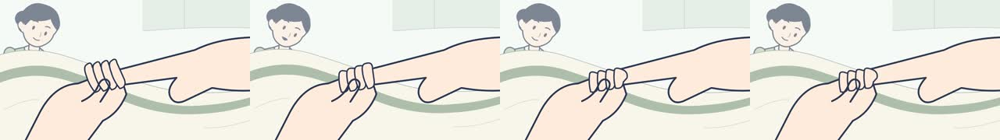

# 02 · Specyfikacja detalu dłoni

1280 × 720, 30 kl./s, lokalne klatki 0–59. Punkt chwytu około (578, 401), zgodny z końcem 01. Skalę zwiększamy cięciem. Na pierwszym planie kontrastowy granatowy kontur obu rąk. W lewym górnym rogu widać twarz Marty w jaśniejszym drugim planie. Koc zasłania jej ramiona. Tak jak na [planszy rodziny](../../../referencje/rodzina-oli-v1.png), jeden szałwiowy pas prowadzi po kocyku do dłoni.

| Klatki | Poza, tkanina i dźwięk |
| --- | --- |
| 0–3 | Palce otwarte. Dłoń Pawła kończy wsuwanie palca z prawej na lewo. Marta kieruje wzrok w dół. Początek kwestii w 2,00 s. |
| 4–35 | Cztery palce domykają się z opóźnieniem przy kolejnych zgięciach. Paweł stabilizuje rękę na początku chwytu. Jedno uniesienie i opadnięcie tkaniny o około 6 px pokazuje oddech. Usta Marty biorą rytm z istniejącego nagrania. |
| 36–53 | Palce trzymają wspólny punkt. Marta zamyka usta. Tkanina osiada, potem cała fotografia pozostaje nieruchoma. |
| 54–57 | Klatka 54 przypada na 3,800 s. Pojedynczy błysk z krótkim zanikiem spotyka klik w 3,805 s. W jego trakcie chwyt zachowuje położenie. |
| 58–59 | Czysty, nieruchomy kadr. Scena 03 pobiera cały obraz funkcją `photo(k)`. |

Szkielet gestu i hierarchię planów wyznacza zbliżenie `reach` w [scenie Mei](https://github.com/kaomei/stickman-video-director/blob/cf78fdb077ce6c9aa43e22786e9f2d0aa122af2d/skills/directing-stickman-videos/examples/b5-mei-event-relay/README.md). Odtworzenie zdjęcia ze wspólnego rysunku odpowiada przejściu od żywego obrazu do zatrzymanego kadru w [PaparazziFlash.tsx](https://github.com/Vincentwei1021/video-shotcraft/blob/59f3e9b9e936ff2bce0e18446226d770a3f2f61f/demos/rhythm/beat-cut-moves/PaparazziFlash.tsx). Rytm słów i migawki opiera się na [nagraniach i rozkładzie efektów](../../../montaz/miks.py).

Odbiór obejmuje widoczne połączenie palca z dłonią Oli, czytelny podział na cztery palce, zanik błysku w czterech klatkach oraz identyczny obraz z `scene(59,k)` i `photo(k)`. Wyciszony detal ma pokazać, że to dziecko zamyka palce. Przy dźwięku klik powinien być słyszalny po „trzyma”.

Sprawdzono 60 wygenerowanych klatek oraz wyrenderowane obrazy 0, 12, 26, 53, 54 i 59. Na arkuszu widać zmiany zgięcia palców i ciągły kontakt z palcem Pawła. Porównanie potwierdziło identyczność czystych klatek 53, 59 i obrazu fotografii oraz dokładnie cztery klatki błysku. Synchronizację sprawdzono na podstawie położenia kliku w miksie. Odsłuch z obrazem należy do odbioru montażu.

## Załączniki do odbioru

[Ujęcie z głosem lub dźwiękiem sceny](ujecie-720p.mp4) · [Załączony przykład warsztatowy](../../przyklady/pozy-postaci.png) · [Autorstwo przykładów](../../przyklady/ZRODLA.md)
