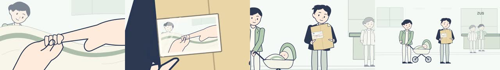

# 03 · Przejście z detalu w plan kolejki

1280 × 720, 30 kl./s, od 4,000 s do cięcia w 6,000 s. Ujęcie 02 udostępnia `photo(k)` z zatrzymanym chwytem. Ten sam rysunek wypełnia powierzchnię odbitki o proporcjach 16:9. Kierunek palca i kolor pasa pozostają rozpoznawalne podczas odjazdu. Kształt teczki i rozmieszczenie rodziny pochodzą z [planszy kolejki](../../../referencje/kolejka-zus-v1.png).

| Klatki | Poza i ruch w kadrze | Akcent |
| --- | --- | --- |
| 0–3 | Kadr po migawce z ujęcia 02. | Piksele identyczne z ostatnią klatką 02. |
| 4–17 | Kamera odchodzi od fotografii, pierwszy skośny pas światła wpada na folię. | W 4,200 s zaczyna się istniejący skrzyp kółka. |
| 18–36 | Paweł podnosi dolny brzeg o kilka pikseli. Tarczą ruchu jest cała teczka, oba nadgarstki obracają się razem z nią. Najjaśniejsza część refleksu mija palce na zdjęciu. | Widać grubość ramki, skraj kieszonki i zagięty róg. |
| 37–53 | Paweł rozluźnia przechył, wzrok kieruje na zdjęcie. W kadrze mieszczą się rodzice, śpiąca Ola i stanowisko po prawej. | Górna krawędź odbitki pozostaje pod folią. |
| 54–59 | Zamknięta teczka w (728,376), szerokość 125, obrót −5°. Marta dotyka rączki wózka, biodra rodziców w (323,445) i (712,438), osie na (474,612). | Ostatni kadr dostępny dla sceny 04 przez `queueShot(k)`. |

Ujęcie działa z istniejącą atmosferą kolejki. Odsunięcie rozwija się wokół jednego motywu jak w [PullBackIsolation](https://github.com/Vincentwei1021/video-shotcraft/blob/59f3e9b9e936ff2bce0e18446226d770a3f2f61f/demos/camera/tension-camera-moves/PullBackIsolation.tsx). Palce i nadgarstki zachowują fizyczne połączenie z rekwizytem jak w [chwycie Mei](https://github.com/kaomei/stickman-video-director/blob/cf78fdb077ce6c9aa43e22786e9f2d0aa122af2d/skills/directing-stickman-videos/examples/b5-mei-event-relay/README.md). Kontrola obejmuje porównanie klatek na obu cięciach, obejrzenie kolejnych faz refleksu oraz pełne pokrycie kadru.

## Załączniki do odbioru

[Ujęcie z głosem lub dźwiękiem sceny](ujecie-720p.mp4) · [Załączony przykład warsztatowy](../../przyklady/ciagly-ruch.jpg) · [Autorstwo przykładów](../../przyklady/ZRODLA.md)
