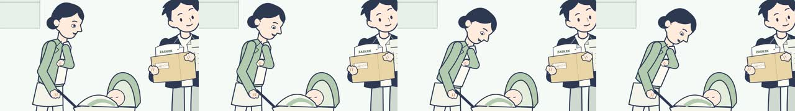

# 07 · Pytanie nad wózkiem

12,00–14,00 s. Klatki lokalne 0–59 odpowiadają 360–419 na zegarze filmu. Przygotować profil Marty z widoczną linią nosa, jednym okiem, niskim kokiem i szałwiowym żakietem. Zachować odległość rączki od gondoli, jeden pas kocyka i otwartą teczkę po stronie Pawła. Układ pochodzi z [planszy kolejki](../../../referencje/kolejka-zus-v1.png).

| Klatki | Poza i ruch |
| --- | --- |
| 0–7 | Cięcie na wysokość wózka. Biodra Marty (323,445), skala 1,05. Tułów pochylony o 13°, wzrok kieruje się w prawo do formularza. Nadgarstek na rączce w (330,467). Paweł nadal ogląda kratki na odwrocie druku. |
| 5–17 | Źrenica schodzi w dół, górna powieka odrobinę się opuszcza. Po niej rusza broda. Głowa obraca się względem szyi z 4° do 16°, w biodrach skłon pogłębia się z 13° do 26°. |
| 13–45 | Przy skłonie bark i łokieć podążają w stronę gondoli. Palce zachowują kontakt z rączką. Górny brzeg kocyka i pas podnoszą się razem, w połowie ujęcia klatka piersiowa Oli osiąga szczyt wdechu. Zamknięte oczy i podwozie pozostają spokojne. |
| 46–59 | Marta mówi ze wzrokiem skierowanym na Olę. Kocyk kończy opadać. Końcowa poza otwiera 08. Dokumenty i Paweł są narysowani także poza krawędzią, by kolejny autor mógł odsłonić ich ruchem kamery. |

Kamera ma stałe przekształcenie `translate(-394 -445) scale(2.25)` w kadrze 1280 × 720. Górna krawędź gondoli biegnie u dołu, Marta jest po lewej, Ola blisko środka. Ostatnia pozycja Pawła to biodra (712,438), skala 1,09, tułów −3°, głowa −9°, spojrzenie w dół. Teczka w (672,392), szerokość 128, kąt −6°, rozwarcie 0,71. Mniejszy druk z nagłówkiem „ZASIŁEK” pozostaje w (665,374), większy gest odwracania kończy się w 06. Z 06 przechodzą też rysunki obu stron formularza.

Wykorzystać fazę `look` w [scenie Mei](https://github.com/kaomei/stickman-video-director/blob/cf78fdb077ce6c9aa43e22786e9f2d0aa122af2d/skills/directing-stickman-videos/examples/b5-mei-event-relay/README.md). Widz rozpoznaje cel spojrzenia po tym, jak źrenica zmienia położenie w nieruchomym przez chwilę konturze oka. Z [JumpCutPunchIn](https://github.com/Vincentwei1021/video-shotcraft/blob/59f3e9b9e936ff2bce0e18446226d770a3f2f61f/demos/rhythm/rhythm-interrupt-moves/JumpCutPunchIn.tsx) pochodzi cięcie do gotowego kadru bez przejazdu w pierwszych klatkach. Dzięki temu Marta może od razu przejąć uwagę od odwróconej kartki.

Dialog „A jak oboje z nią zostaniemy, to oboje dostaniemy zasiłek?” zaczyna się w istniejącym miksie o 11,65 s. Usta odczytują kolejne próbki Marty z [obwiedni głosu](../../../montaz/assets/mowa.json), również na styku z 08. Dźwięk korytarza płynie pod pytaniem.

Do odbioru porównać początek, skierowanie oka w dół, dół skłonu i wyjście. Sprawdzić wszystkie 60 klatek pod kątem stałego chwytu, maksimum wdechu w połowie ujęcia oraz ciągłości kadru i ust przy przejściu 07–08.

Obejrzano render klatek 0, 15, 29 i 59. Widać opuszczenie źrenicy przed skłonem, niski kok w profilu i palce zachodzące na ciemny uchwyt. Górna krawędź kocyka unosi się przed nieruchomym policzkiem Oli. Test wszystkich 60 klatek potwierdził chwyt w (330,467), wdech z wydechem i zgodność całego obrazu między końcem 07 a pierwszą klatką 08. [Test sceny](scene.test.mjs)

## Załączniki do odbioru

[Ujęcie z głosem lub dźwiękiem sceny](ujecie-720p.mp4) · [Załączony przykład warsztatowy](../../przyklady/fazy-ruchu.png) · [Autorstwo przykładów](../../przyklady/ZRODLA.md)
