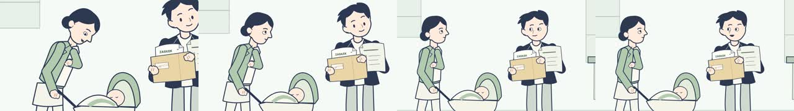

# 08 · Oczy, potem głowa

14,00–16,00 s, klatki filmu 420–479, 1280 × 720, 30 kl./s. Pierwsza klatka przejmuje postaci, otwartą teczkę, wydruki, chwyt rączki i kamerę z końca 07. Kadrowanie zachowuje układ rodziców względem śpiącej Oli z [referencji kolejki](../../../referencje/kolejka-zus-v1.png).

| Klatki lokalne | Gra i kamera |
| --- | --- |
| 0–2 | Marta wciąż pochyla się nad Olą. Przechodzi z końca 07 bez przerwy w mówieniu. |
| 3–9 | Źrenice Marty wędrują znad kocyka ku Pawłowi. Do klatki 9 kąt jej głowy i tułowia pozostaje stały. Wzrok wyprowadza z pozy skłonu, dla której wzorem jest postać przed ekranem na [planszy Stickman](https://github.com/kaomei/stickman-video-director/blob/cf78fdb077ce6c9aa43e22786e9f2d0aa122af2d/skills/directing-stickman-videos/assets/b1/character-acting-reference.png). |
| 9–29 | Marta unosi głowę, po pięciu klatkach dołączają plecy. Dłoń pozostaje na rączce. Kamera otwiera kadr z obu stron rodziców, ze skali 2,25 do 1,80, i hamuje na ich twarzach. Jeden płynny odjazd przejmujemy z [PullBackIsolation](https://github.com/Vincentwei1021/video-shotcraft/blob/59f3e9b9e936ff2bce0e18446226d770a3f2f61f/demos/camera/tension-camera-moves/PullBackIsolation.tsx). |
| 26–43 | Paweł przenosi wzrok z odwrotu druku w lewo na Martę. Po sześciu klatkach unosi głowę. Palce nadal podpierają druk i teczkę w miejscach z 07. |
| 44–59 | W nieruchomym kadrze czytamy odpowiedź z jego twarzy. W ostatniej klatce Paweł zaczyna „Nie wiem”, co prowadzi do ruchu kolejki w 09. |

Obwiednie z [mowa.json](../../../montaz/assets/mowa.json) sterują ustami obojga przez cały zakres. Ostatnia niezerowa próbka Marty przypada na klatkę 18, pierwsza Pawła na 59. Przez przerwę między głosami słychać tło korytarza z [miksu](../../../montaz/miks.py).

Przy odbiorze porównujemy geometrię klatki 0 z wyjściem 07. Na klatkach 3–9 muszą zmienić się oczy bez ruchu głowy, a Paweł ma zacząć reakcję po Marcie. Na klatce 43 obie twarze, rączka wózka i otwarta teczka powinny mieścić się w kadrze. Przez całe ujęcie pozycje wydruków i dłoni Pawła są stałe w przestrzeni kolejki.

W renderze sprawdzono klatki 0, 9, 25, 32, 43 i 59. W klatce 9 oko Marty odchodzi od kocyka przy wciąż opuszczonej brodzie. Gdy Paweł podnosi wzrok, widać jasne brzegi oczu, a nos obraca się w lewo. Na klatce 59 otwiera usta przy nieruchomych dokumentach. Test porównuje pełny rysunek na styku 07–08 i pozycje obu dłoni Pawła oraz teczki we wszystkich 60 klatkach.

## Załączniki do odbioru

[Ujęcie z głosem lub dźwiękiem sceny](ujecie-720p.mp4) · [Załączony przykład warsztatowy](../../przyklady/fazy-ruchu.png) · [Autorstwo przykładów](../../przyklady/ZRODLA.md)
