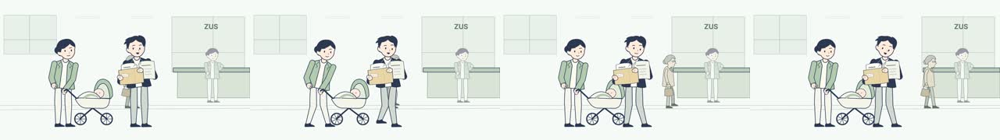

# 09 · Krok kolejki

16,00–18,00 s. Lokalne klatki 0–59, globalne 480–539. Nieruchoma kamera, 1280 × 720 przy 30 kl./s.

| Klatki | Obraz |
| --- | --- |
| 0–7 | Cięcie ze skali 1,80 sceny 08 do 1,00. Marta po lewej przy rączce, Paweł po prawej z otwartą teczką i dwoma wydrukami. Klientka z torbą rusza w stronę prawej krawędzi. |
| 8–23 | Wózek toczy się w prawo. Marta stawia stopę, uchwyt pozostaje pod jej dłonią. Paweł zerka za siebie, unosi i przestawia lewy but. Prawy but wyznacza stały punkt podparcia. |
| 24–34 | Paweł przenosi biodra z x=712 do x=686. Krawędź kurtki styka się z budką. Osie kół osiągają x=535, obrót wynika z 61 px drogi i promienia 29 px. |
| 35–50 | Rodzice utrzymują wózek. Klientka mija Pawła na drugim planie. Torba zwisa po przeciwnej stronie względem wykroku. |
| 51–59 | Oczy Pawła wracają do papierów, głowa podąża za nimi. Otwartą teczkę przekazujemy do 10 ze środkiem (646,392), szerokością 128 i obrotem −6°. Środki druków wynoszą (639,374) i (726,362). |

Usta Pawła bierze się z globalnych klatek [obwiedni dialogu](../../../montaz/assets/mowa.json). W czasie oddechu między frazami są zamknięte. Gra w [scenariuszu](../../../../../PLAN-FILMU-DEMO.md) przypada na „Nie wiem. Czytałem na stronie ZUS-u”.

Odbiór obejmuje porównanie początku, największego wykroku, chwili kontaktu oraz ostatniej klatki. W każdym z tych obrazów muszą zmieścić się buty i opony. Od klatki 34 koła utrzymują kierunek szprych, klientka nadal idzie, a dłonie Pawła pozostają przy dokumentach. Gest nacisku opieramy na środkowej sylwetce przy stosie z [arkusza Stickman](https://github.com/kaomei/stickman-video-director/blob/cf78fdb077ce6c9aa43e22786e9f2d0aa122af2d/skills/directing-stickman-videos/assets/b1/approved-2026-10-23-motion-sheet.png). Skok skali bierze wzór z pierwszej zmiany planu w [JumpCutPunchIn](https://github.com/Vincentwei1021/video-shotcraft/blob/59f3e9b9e936ff2bce0e18446226d770a3f2f61f/demos/rhythm/rhythm-interrupt-moves/JumpCutPunchIn.tsx).

## Załączniki do odbioru

[Ujęcie z głosem lub dźwiękiem sceny](ujecie-720p.mp4) · [Załączony przykład warsztatowy](../../przyklady/fazy-ruchu.png) · [Autorstwo przykładów](../../przyklady/ZRODLA.md)
