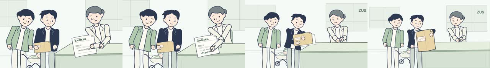

# 14 · Dopisek i zamknięcie teczki

26,00–28,00 s. Lokalnie 0–59, globalnie 780–839, 30 kl./s, SVG 1280 × 720. Używamy blatu, pracownicy i formularza ze sceny 12. Współrzędne poniżej podano w układzie rysunku stanowiska, a od klatki 48 również w układzie ekranu. [Stanowisko](../12/scene.mjs) · [Plansza poczekalni](../../../referencje/kolejka-zus-v1.png) · [Specyfikacja produkcji](../../PRODUKCJA.md)

| Klatki | Akcja i kryterium obrazu |
| --- | --- |
| 0–6 | Przejęcie końca sceny 13. Kamera ma początkowo przesunięcie (−130,−90) i powiększenie 1,24. Papier pozostaje środkiem w (816,463), z obrotem −10° i głębokością 0,78. Lewa ekranowa ręka pracownicy wraca z daty na prawy brzeg papieru. |
| 7–23 | Czubek długopisu nakreśla „do jutra” od lewej w wierszu y=74. Ślad przylega do papieru i później odjeżdża razem z nim. Marta obserwuje pisownię, zaczyna przytakiwać. |
| 24–30 | Długopis wraca nad blat. Marta prostuje głowę. Paweł podtrzymuje teczkę od spodu lewą dłonią, prawą chwyta lewy brzeg kartki. Pracownica puszcza dopiero po przejęciu. |
| 31–44 | Paweł ściąga druk w lewo pod okładkę i dosuwa go palcami. Krawędź okładki kolejno zasłania nadruk i dopisek. Odsunięcie kamery przywraca cały kontuar i swobodę ruchu przedramienia. |
| 45–52 | Widać zamknięcie. Zdjęcie pozostaje na wierzchu. Prawy nadgarstek obejmuje prawy górny brzeg okładki, lewa ręka zwalnia chwyt. |
| 53–59 | Teczka opada przed tułowiem. Ostatnie dwie pozycje środka to (606,422) i (607,428). Szerokość 190 px, obrót −8°, otwarcie 0. Prawy nadgarstek jest w punkcie środek+(61,−63), dłoń 125°, s=1,247, chwyt hold. Scena 15 zaczyna od (608,434) i prędkości (+1,+6) px/kl. |

Obwiednia głosu pracownicy pochodzi z klatek 780–839. Pod koniec powinno być słychać „do jutra”. Stuk teczki następuje w następnym ujęciu przy zetknięciu z kanapą. [Polskie dialogi](../../../montaz/assets/mowa.json) · [Scenariusz dźwiękowy](../../../../../PLAN-FILMU-DEMO.md)

Odbiór bez dźwięku obejmuje zgodność czubka i końca kreski, pojedyncze kiwnięcie, nakładanie chwytów i ciągłość matowej okładki ze zdjęciem przez cięcie. Kontakt przed poruszeniem arkusza sprawdzamy według przykładu Mei. Schodzenie jednej krawędzi pod drugą porównujemy z lokalnym przykładem stosu. [Stickman, kontakt Mei](https://github.com/kaomei/stickman-video-director/blob/cf78fdb077ce6c9aa43e22786e9f2d0aa122af2d/skills/directing-stickman-videos/examples/b5-mei-event-relay/stage.cjs#L26) · [Video Shotcraft, card stack](https://github.com/Vincentwei1021/video-shotcraft/blob/59f3e9b9e936ff2bce0e18446226d770a3f2f61f/gallery/media/poster/card-stack.jpg) · [Lokalna klatka](../../przyklady/stos-kart.jpg)

## Załączniki do odbioru

[Ujęcie z głosem lub dźwiękiem sceny](ujecie-720p.mp4) · [Załączony przykład warsztatowy](../../przyklady/fazy-ruchu.png) · [Autorstwo przykładów](../../przyklady/ZRODLA.md)
