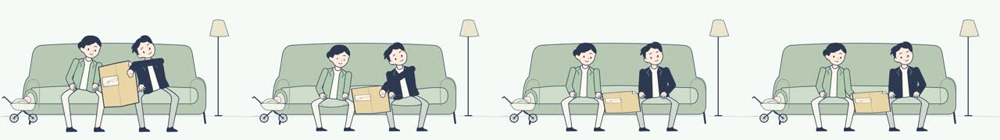

# 15 · Kontakt teczki i osiadanie rodziców

SVG 1280 × 720, klatki 840–899 filmu, lokalnie 0–59 przy 30 kl./s. Oś kamery przechodzi między rodzicami. Podłoga, wózek, lampa i tył kanapy stoją nieruchomo. Marta ma kurtkę w kolorze szałwii. [Plansza salonu](../../../referencje/kanapa-przed-fala-v1.png) · [Wspólne proporcje](../../PRODUKCJA.md)

| Klatka | Pozycja i odbiór |
| --- | --- |
| 0–6 | Środek zamkniętej teczki idzie z (608,434) do (614,470), stale (+1,+6) px/klatkę. Szerokość 190, obrót −8°. Nadgarstek Pawła na prawym górnym brzegu pozostaje w punkcie środek+(61,−63), dłoń 125°, skala 1,247, chwyt hold. W klatce 6 dolny lewy róg jest blisko (539,588). |
| 7–19 | Dolna krawędź zatrzymuje się przy brzegu kanapy. Paweł pochyla teczkę na poszycie. Zdjęcie i zagięty róg skracają się wraz z okładką. Pierwsze wgniecenie pod biodrami Marty narasta przed drugim po stronie Pawła. |
| 20–34 | Poduszka wraca kilka pikseli po pierwszym nacisku. Druga strona dochodzi do najniższego położenia pod Pawłem. Głowy i ramiona nadążają za biodrami z niewielkim opóźnieniem. Paweł otwiera palce i zabiera rękę nad prawe udo. |
| 35–59 | Koniec osiadania. Marta ustawia przedramię przy teczce i patrzy na jej brzeg. Oboje siedzą przy s=1,16. Te same zamknięte okładki przechodzą do kolejnego ujęcia. |

**Przekazanie do 16.** Teczka ma środek (621,526), w=190, obrót −5°, otwarcie 0 i rzut pionowy 0,48 wokół środka po obrocie. Biodra Marty (427,490), lean=3°, head=6°, gaze=0,9, gazeDown=0,9, left=[−64,−40,−49,−8], right=[66,−23,85,1]. Biodra Pawła (800,490), lean=−4°, head=−9°, gaze=−0,85, gazeDown=1, left=[−64,−35,−64,−8], right=[74,−46,48,−7]. Otwarte dłonie, zamknięte usta, brwi w spoczynku. Końcowy salon daje `restingRoom(k)`, a okładki `restingFolder(k)`.

Cichy stuk w klatce 6 (28,20 s). Sprężyna i tarcie tapicerki towarzyszą osiadaniu, rodzice słuchają końcówki „do jutra”. W tym ujęciu usta pozostają zamknięte. Odbiór obejmuje zgodność cięcia na ruchu i kontakt przed reakcją poduszki. Najniższe położenia obu bioder należy odczytać osobno przy wyciszeniu. [Scenariusz z dźwiękiem](../../../../../PLAN-FILMU-DEMO.md)

Na arkuszu pozy Stickman ręka i pochylenie tułowia wskazują odbiorcy ten sam cel. Tutaj oczy Marty wyprzedzają ostatni ruch przedramienia. W arkuszu faz ruchu najniższa poza ma odrębną sylwetkę przed wyprostowaniem. U nas podkreśla ją boczny szew poduszki. [Stickman · gra postaci](../../przyklady/pozy-postaci.png) · [Stickman · fazy ruchu](../../przyklady/fazy-ruchu.png) · [Oryginalne pliki i rewizje](../../przyklady/ZRODLA.md)

## Załączniki do odbioru

[Ujęcie z głosem lub dźwiękiem sceny](ujecie-720p.mp4) · [Załączony przykład warsztatowy](../../przyklady/ciagly-ruch.jpg) · [Autorstwo przykładów](../../przyklady/ZRODLA.md)
