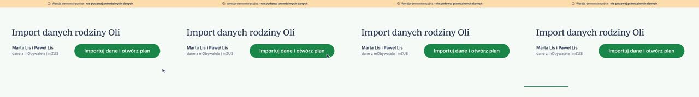

# Ujęcie 21 · Klatki i odbiór

Pełny kadr 1280 × 720, 30 kl./s. Klatki filmu 1200–1259. Współrzędne liczymy od lewego górnego narożnika. Tło w kolorze powierzchni aplikacji #F5FAF7, bursztynowy pasek #FCDCAA, tekst #283754, przycisk #1A8648. [Kolory aplikacji](../../../../../app/src/app/globals.css)

Pasek demonstracji o wysokości 54 px zawiera ikonę informacji i cały komunikat z DemoBar. Tytuł sekcji na x=86, y=263, Domine 64 px. Poniżej dwuwierszowy podpis rodziców i źródeł w Inter. Filmowy detal korzysta z tekstów widocznych po wejściu na /logowanie oraz danych rodziny Oli. [DemoBar](../../../../../app/src/features/auth/auth-shell.tsx) · [Układ importu](../../../../../app/src/features/auth/ezus/ezus-methods.tsx) · [Rodzina Oli](../../../../../app/src/lib/family/ola.ts)

| Klatki | Zdarzenie |
| --- | --- |
| 0–13 | Ostre cięcie. Lewy brzeg przycisku na x=545, środek (859,378), rozmiar 628 × 104 px. To 49% szerokości obrazu. Grot zbliża się od (1188,507) do (1112,400) po łuku. |
| 14–17 | Grot zatrzymuje się w prawej części kapsuły. Na „loguje” skala maleje do 0,95 względem środka. Biały podpis porusza się razem z wypełnieniem. |
| 18–32 | Przycisk wraca do skali 1 z wykładniczym wyhamowaniem. Kursor zwalnia nacisk i odchodzi od przycisku. |
| 33–40 | Oko ma czas odczytać pełną akcję i źródła. |
| 41–59 | Pozioma linia #1A8648 o grubości 5 px rośnie na y=641. Na ostatniej klatce jej oś biegnie od x=−4 do x=320, zwrot w prawo, prędkość około 18 px/kl. Punkt przejścia do ujęcia 22 to (320,641). |

Istniejący głos narratora „Marta loguje się mObywatelem” wchodzi w miksie przy 40,12 s. Nacisk przypada około 40,53 s. Kamera oraz oznaczenie demonstracji pozostają nieruchome. Przy odbiorze obejrzeć klatki 0, 17, 32 i 59, przeczytać CTA w pomniejszeniu i porównać długość linii przed cięciem. [Miks narracji](../../../montaz/miks.py)

Kształt kapsuły i kolor pochodzą z wariantu primary. Gwałtowny powrót pochodzi z przebiegu snapRamp zastosowanego w lokalnym montażu, kolor i pełny podpis umożliwiają rozpoznanie akcji po puszczeniu kursora. [AppButton](../../../../../app/src/components/ui/AppButton.tsx) · [Motionmaxxing · runtime](https://github.com/Tejashmakwana/motionmaxxing/blob/8c8ec0f2a6f6c9a0da15cd24f7b1298ab298368c/runtime/motion.js) · [Bang Motion · detal interfejsu](../../przyklady/ruch-produktu.jpg) · [Video Shotcraft · ruch kursora](../../przyklady/gest-interfejsu.jpg)

## Załączniki do odbioru

[Ujęcie z głosem lub dźwiękiem sceny](ujecie-720p.mp4) · [Załączony przykład warsztatowy](../../przyklady/gest-interfejsu.jpg) · [Autorstwo przykładów](../../przyklady/ZRODLA.md)
