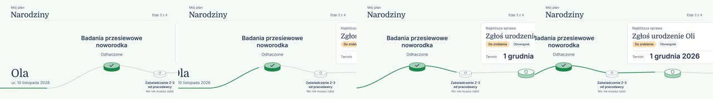

# Ujęcie 22 · Parametry ruchu i odbiór

1280 × 720, 30 kl./s, klatki filmu 1260–1319. Imię i tytuł etapu w Domine, podpisy mapy w Inter, tytuł karty w Domine. Tło #F5FAF7, obrys #D4D7DD, tekst #283754. Pokazujemy wycinek poziomej mapy oraz kartę najbliższej sprawy w jednej przestrzeni montażowej. [Paleta](../../../../../app/src/app/globals.css) · [Mapa produktu](../../../../../app/src/features/journey-map/JourneyMap.tsx)

| Klatka | Co widać |
| --- | --- |
| 0 | Prowadnica wchodzi przy x=−4 na y=641. Koniec jej zielonego odcinka przesunął się z x=320 do 338. Po lewej stoją „Ola” i „10 listopada 2026”. |
| 1–24 | Kamera rozpędza się do 12 px/kl w prawo. Kreska wspina się do podestu badań. Nazwa i status stoją nad jego blatem. |
| 25–42 | Ślad dosięga odhaczonych badań. Znacznik wędruje przez środek obrazu, wyżej niż przystanek Z-3. |
| 43–59 | Z prawej wjeżdża podest zgłoszenia i jego karta. W klatce 59 przesunięcie kamery wynosi 594 px, koniec śladu w świecie x=1458. Karta od x=666 do 1314 w obrazie. |

W danych planu Oli badania są odhaczone, Z-3 to sprawa automatyczna pracodawcy. Zgłoszenie urodzenia ma stan „Do zrobienia” i termin 1 grudnia 2026. Karta pokazuje pola „Najbliższa sprawa” i „Termin”. [Dane spraw](../../../../../app/src/lib/demo/fixtures.ts) · [Statusy ścieżki](../../../../../app/src/lib/plan/status.ts) · [Wybór najbliższej sprawy](../../../../../app/src/lib/plan/path.ts)

Scena 23 może importować funkcję drawMap(cameraX, traceX, cardOffset=0). Dodatnie cameraX przesuwa całą mapę w lewo, traceX to współrzędna końca śladu na mapie. Dodatni cardOffset odsuwa kartę od podestu w prawo podczas hamowania. W świecie karta ma x=1260, y=164, szerokość 648, wysokość 300. Data ma 50 px, czyli 14 px przy podglądzie o szerokości 360 px. Podest aktualnej sprawy ma x=1584. Naturalna kolejna klatka ma cameraX=606 i traceX=1478.

Przy odbiorze obejrzeć klatki 0, 30, 42 i 59 w pomniejszeniu. W czasie jazdy znacznik odhaczenia i napis powinny pozostawać czytelne, a po cięciu do 23 kontur karty ma przesunąć się o jeden krok kamery. Słowom lektora towarzyszy istniejący motyw 60 BPM. Zachowujemy gest w kierunku czytania oraz jedno ognisko uwagi w kadrze. [Bang Motion · przykład ciągłego ruchu](https://github.com/bangtutorial/bang-motion/blob/c1aa65e921c970d858705fcb4a53a8294d1a4131/docs/gallery/05-continuous-action.jpg) · [Bang Motion · przykład pracy z detalem interfejsu](https://github.com/bangtutorial/bang-motion/blob/c1aa65e921c970d858705fcb4a53a8294d1a4131/docs/gallery/03-saas-ui-tour.jpg)

## Załączniki do odbioru

[Ujęcie z głosem lub dźwiękiem sceny](ujecie-720p.mp4) · [Załączony przykład warsztatowy](../../przyklady/ruch-produktu.jpg) · [Autorstwo przykładów](../../przyklady/ZRODLA.md)
