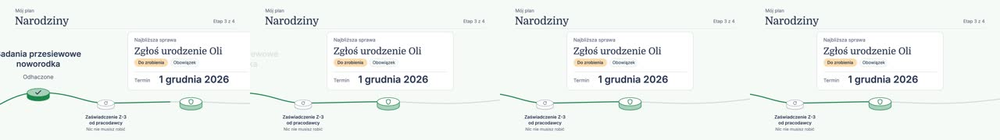

# Ujęcie 23 · Hamowanie i zatrzymanie terminu

Klatki filmu 1320–1379, 1280 × 720, 30 kl./s. Wszystkie obiekty pochodzą z tego samego rysunku mapy co w ujęciu 22. Skala, nagłówek etapu i położenie pionowe karty są stałe. [Mapa z ujęcia 22](../22/scene.mjs) · [Komponent karty sprawy](../../../../../app/src/features/journey-map/CaseCard.tsx)

| Klatki lokalne | Pozycja i akcja |
| --- | --- |
| 0 | Kamera na x=606, przyrost od ostatniego kadru 22 wynosi 12 px. Ślad na x=1478 w świecie, przyrost 20 px. Lewy brzeg karty na x=654 w obrazie. |
| 1–11 | Ślad zwalnia na podjeździe do punktu zgłoszenia. Na klatce 11 sięga x=1584, dokładnie na osi podestu. Kamera nadal jedzie w prawo. |
| 12–27 | Opis sprawy zostaje nieco w tyle za ruchem podestu. Różnica osiąga 10 px w klatce 21, potem łagodnie maleje. |
| 28–29 | Kamera zatrzymuje się na x=918. Oś podestu w obrazie to (666,523). Karta kończy pozostały ruch w lewo. |
| 30–59 | Pełna sekunda identycznych klatek. Karta zajmuje x=342…990 i y=164…464. Tytuł „Zgłoś urodzenie Oli”, status „Do zrobienia” i termin „1 grudnia 2026” mieszczą się w obrębie karty. |

Termin jest składany krojem Inter 600 o wielkości 50 px. Daje to 14,1 px po pomniejszeniu filmu do szerokości 360 px. Kontrolę stanowi odczyt całej daty w takim kadrze oraz porównanie klatek 30 i 59. Dla ujęcia 24 funkcja `mapAtRest()` zwraca ostatnią klatkę. Prawa krawędź białej karty ma x=990. [Dane terminu](../../../../../app/src/lib/demo/fixtures.ts)

Narrator kończy wypowiedź „…i co trzeba zrobić teraz”. Motyw 60 BPM przechodzi przez cięcie. Dojazd i zatrzymanie odbywają się pod głosem. [Miks pierwszej minuty](../../../montaz/miks.py)

Współdzielenie rysunku zachowuje sylwetkę obiektu na granicy ujęć jak w przykładzie Bang Motion. Dojazd ma wyraźny koniec i statyczny czas odczytu zgodny z przykładami krzywych Motionmaxxing. [Bang Motion · Continuous Action](https://github.com/bangtutorial/bang-motion/blob/c1aa65e921c970d858705fcb4a53a8294d1a4131/docs/gallery/05-continuous-action.jpg) · [Motionmaxxing · przebiegi krzywych](https://github.com/Tejashmakwana/motionmaxxing/blob/8c8ec0f2a6f6c9a0da15cd24f7b1298ab298368c/docs/media/eases.svg)

## Załączniki do odbioru

[Ujęcie z głosem lub dźwiękiem sceny](ujecie-720p.mp4) · [Załączony przykład warsztatowy](../../przyklady/ruch-produktu.jpg) · [Autorstwo przykładów](../../przyklady/ZRODLA.md)
