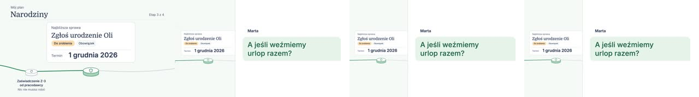

# Ujęcie 24 · Granica mapy i rozmowy

1280 × 720, 30 kl./s, klatki filmu 1380–1439. Rysunek z końca ujęcia 23 dostarcza `mapAtRest()`. Karta „Zgłoś urodzenie Oli” ma pierwotnie 648 × 300 px, prawy bok na x=990 i termin 1 grudnia 2026. Dane i hierarchia karty pochodzą z widoku sprawy. [Karta w aplikacji](../../../../../app/src/features/journey-map/CaseCard.tsx) · [Mapa na wejściu](../22/SPEC.md)

| Klatki | Obraz |
| --- | --- |
| 0 | Ostatni rysunek sceny 23 w skali 1. |
| 1–13 | Mapa przesuwa się i oddala wokół punktu na prawej krawędzi karty, na wysokości y=325. Wzdłuż tej krawędzi pojawia się biały panel. Nagłówek etapu i dalsze przystanki tracą kontrast. |
| 14–21 | W odsłoniętej rozmowie wchodzi jedna grupa zawierająca podpis „Marta” i cały dymek. Oba wiersze pytania pojawiają się równocześnie. |
| 22–25 | Karta dojeżdża do x=427 i skali 0,60. Jej lewy brzeg znajduje się na x=38. |
| 26–59 | Nieruchomy podział. Na 853 px białego pola widnieje dymek w kolorze #E6F3E9, z literami #176343. Tekst zaczyna się na x=518, linie bazowe leżą na y=350 i 414. Ujęcie 25 przejmuje x=518 pod odpowiedź Zusika. |

Lektor wchodzi około 46,2 s. Dymek to pojedyncza wypowiedź zsynchronizowana z frazą o wspólnym urlopie. Zachowujemy nagrany głos i ciągły motyw muzyczny. Przy odbiorze porównać klatkę 0 z końcem 23, obejrzeć początek ruchu i pierwsze pojawienie się pytania. W klatce 59 treść pytania i data po lewej muszą mieścić się w całości. [Rytm lektora](../../../../../PLAN-FILMU-DEMO.md) · [Bang Motion · przejęcie czynności](https://github.com/bangtutorial/bang-motion/blob/c1aa65e921c970d858705fcb4a53a8294d1a4131/docs/gallery/05-continuous-action.jpg) · [Motionmaxxing · wyhamowanie](https://github.com/Tejashmakwana/motionmaxxing/blob/8c8ec0f2a6f6c9a0da15cd24f7b1298ab298368c/runtime/motion.js#L28-L35)

## Załączniki do odbioru

[Ujęcie z głosem lub dźwiękiem sceny](ujecie-720p.mp4) · [Załączony przykład warsztatowy](../../przyklady/ruch-produktu.jpg) · [Autorstwo przykładów](../../przyklady/ZRODLA.md)
