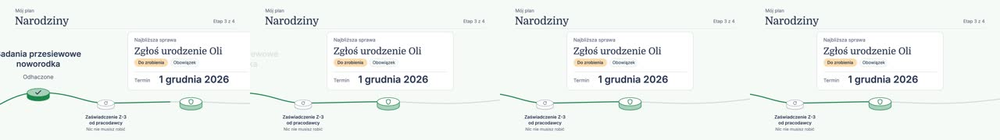

# Druga część filmu · od kliku do landingu

**Decyzja reżyserska.** Zachowaj mapę Oli z v2, w tym kolejność spraw, podesty, jazdę kamery i sekundę na przeczytanie terminu. Na jej końcu widz ma zrozumieć trzy rzeczy po wyciszeniu głosu. Marta może zapytać o wspólny urlop, zobaczyć podstawę odpowiedzi i przenieść swój wybór do szkicu. Zusik pojawia się wtedy, gdy jego gest pomaga przenieść wzrok. [Obecna mapa w ruchu](../v2/sceny/22/ujecie-720p.mp4) · [Zatrzymanie na terminie](../v2/sceny/23/klatki.jpg) · [Mapa aplikacji](../../../app/src/features/journey-map/JourneyMap.tsx)

## Jeden Zusik, trzy role w opowieści

| Moment | Co już ma aplikacja | Co ma wykonać Claude w filmie |
| --- | --- | --- |
| Zatrzymanie fali i powrót do widza | Stan `available`, oryginalny kontur, spoczywające ramiona, oczy, refleksy i cień. | W 19–20 połącz oko Zusika ze środkiem fali. Jeden niski ruch osiadania i spojrzenie na odsłaniany tytuł. W finale wróć do neutralnej pozy z wzorca. |
| Odpowiedź na pytanie Marty | Stan `answering` ma istniejące pozy ust. Postać ma osobne źrenice, bliki i ramiona. | W 25 przy pojawieniu się odpowiedzi użyj jednego krótkiego otwarcia ust. Potem usta odpoczywają, obie źrenice wskazują odnośnik, a dopiero za nimi idzie lekkie pochylenie ciała. Narrator nadal jest głosem zespołu. |
| Skąd pochodzi odpowiedź | W stanie `reading` oryginalny obrys przechodzi w otwartą książkę; model zawiera warstwy stron i ruch czytania. | W 26 zrób jedną przemianę na oczach widza. Jasna strona książki rozkłada się w kartę cytatu. Kiedy karta już niesie tekst, kończy się ruch maskotki. To nowa inscenizacja istniejącej pozy. |

Dla każdej pozy użyj tego samego modelu, półksiężyca, trzech kropek i cienia. W bazowej implementacji bliki podążają za źrenicami na jedną piątą dystansu. Wzór neutralny przedstawia twarz o zaokrąglonych oczach i ramiona wyrastające z boków. [Wzorzec graficzny](../../../maskotka_kod/design/mascot/base.jpg) · [Dokumentacja porównania z wzorcem](../../../maskotka_kod/design/mascot/REPORT.md) · [Stany i parametry](../../../app/src/components/mascot/babelek/types.ts) · [Pozy i ruch źrenic](../../../app/src/components/mascot/babelek/useStateAnimation.ts)

**Warunek techniczny.** W v2 odwołanie `k.zusik(..., look)` rysuje statyczne `<Babelek/>` przez SVG `use`. Warstwy książki są w oryginalnym komponencie montowane przy `animated`. Samo ustawienie nazwy stanu w scenie v2 ich nie doda. Przygotuj w źródłach filmu jedną instancję korzystającą z oryginalnego rysunku, geometrii książki i warstw twarzy. Próbkuj postęp z numeru klatki HyperFrames/Remotion. Animacja interaktywna aplikacji korzysta także z losowych przerw i zegara przeglądarki. Sprawdź tę samą klatkę po skoku z obu stron osi i po świeżym uruchomieniu. Jeśli książka zasłania cytat w próbie 720p, uprość gest do śledzenia tekstu oczami i zachowaj tę samą kartę źródła. [Osadzenie w filmie v2](../v2/film.tsx) · [Oryginalny rysunek](../../../app/src/components/mascot/babelek/Babelek.tsx) · [Geometria przemian](../../../app/src/components/mascot/babelek/shapes.ts) · [Warstwy i zegar aplikacji](../../../app/src/components/mascot/babelek/AnimatedSvg.tsx)

## Plan pracy scena po scenie

Każdy wiersz jest briefem do oddzielnego planu i specyfikacji danego ujęcia. W lokalnym układzie 1280 × 720 jedna scena trwa 60 klatek przy 30 kl./s. Numery w tabeli oznaczają klatki lokalne. Użyj istniejącego polskiego nagrania. Synchronizuj z rzeczywistą sylabą w miksie. [Plan i tekst mówiony](../../../PLAN-FILMU-DEMO.md) · [Miks odniesienia](../v2/media/miks.flac)

| Scena i czas | Ruch do zrealizowania | Próba odbiorowa |
| --- | --- | --- |
| **20 · 38–40 s** | Otwórz ostatnią pozą przebudowanej sceny 19. Pierwsze sześć klatek utrzymuje ostrego oryginalnego Zusika nad zastygłymi papierami na rozmytym tle. Dopiero teraz mięta zastępuje salon, a jedno osiadanie i przesunięcie odsłania nazwę. | Odtwórz 36–40. Rodzinę i Zusika widać razem przed wejściem tytułu. Od klatki 45 cały tytuł „Przewodnik Rodzica” pozostaje nieruchomy. [Referencja pomostu](../referencje/fala-formularzy-zusik-v1.png) |
| **21 · 40–42 s** | Lewy brzeg tytułu prowadzi do przycisku „Importuj dane i otwórz plan”. Na „loguje” nacisk, jedno wyhamowanie, przy dolnej krawędzi rusza zielona linia. | Widoczne oznaczenie demonstracji, mObywatel i mZUS. Na cięciu do mapy linia podąża w tym samym kierunku. [Widok importu](../../../app/src/features/auth/open-family-plan.tsx) |
| **22 · 42–44 s** | Przenieś gotową jazdę v2. Od „Ola” przez „Badania przesiewowe noworodka” i status „Odhaczone” do kolejnego podestu. Prowadzi linia na mapie. | Obejrzyj obie wersje w tym samym tempie. Środki podestów, kolejność etapów i kierunek jazdy pokrywają się. [Ścieżka z aplikacji](../../../app/src/features/journey-map/HorizontalPath.tsx) · [Ujęcie bazowe](../v2/sceny/22/scene.mjs) |
| **23 · 44–46 s** | Przenieś wyhamowanie o pół karty na „Zgłoś urodzenie Oli”. Zachowaj pierwotne nazwę, termin i status z przebiegu demonstracyjnego. | Ostatnie 30 klatek pozwala odczytać „1 grudnia 2026” i „Do zrobienia” przy szerokości podglądu 360 px. Prawa krawędź karty trafia na początek 24. [Oryginalna karta](../../../app/src/features/journey-map/CaseCard.tsx) · [Wyjście ujęcia 23](../v2/sceny/23/SPEC.md) |
| **24 · 46–48 s** | Ta sama krawędź przesuwa się w lewo do x=427. Czat otrzymuje dwie trzecie kadru, odsłaniając naraz tekst „A jeśli weźmiemy urlop razem?”. | Od pierwszej czytelnej klatki pytanie ma komplet słów. Pozostaje miejsce w kadrze na odpowiedź od x=518 w 25. [Układ z v2](../v2/sceny/24/klatki.jpg) |
| **25 · 48–50 s** | Podpis „Agent AI · RAG”, Zusik i odpowiedź „Oboje możecie korzystać z urlopu jednocześnie.” Pierwsze 12 klatek na odpowiedź, w środkowej części oczy prowadzą widza w dół do „Kodeks pracy · art. 182¹a § 6”. | Po wyciszeniu da się wskazać cel spojrzenia. Ostatnia poza i pozycja odnośnika stają się pierwszym kadrem 26. [Odpowiedź i odnośnik](../v2/sceny/25/scene.mjs) |
| **26 · 50–52 s** | W klatkach 1–18 rozłóż książkę w kartę źródła. Podpis przepisu utrzymuj przy jego dotychczasowej kotwicy; gołym okiem można powiązać odnośnik z cytatem. Podkreślenie zatrzymuje się pod „jednocześnie”. | Dokładne pierwsze zdanie z `kp-art182-1a-par6` oraz wydawca „Sejm RP”. Od klatki 30 cały cytat stoi. Podkreślenie na (227,429) przejdzie pod daty w 27. [Korpus sprawy Marty](../../../app/corpus/marta/fragments.jsonl) · [Obecny układ cytatu](../v2/sceny/26/klatki.jpg) |
| **27 · 52–54 s** | Podkreślenie przepisu przejmują daty „11 stycznia – 7 lutego 2027”. „Razem z Pawłem” i ten sam ciąg znaków trafiają do szkicu. Przesuń pod daty powierzchnię pola; etykieta „Okres urlopu” ma osobny tor nad nimi. | Prześledź cyfry przez cały ruch. Krawędź pola ani etykieta nie przecinają znaków, a na końcu widać nagłówek wniosku. Porównaj zwłaszcza klatki 20, 30, 40. [Pola szkicu](../../../app/src/features/chat/draft-form.tsx) · [Ruch dat w v2](../v2/sceny/27/klatki.jpg) |
| **28 · 54–56 s** | Jedyny wiersz „Odpis aktu urodzenia Oli” opuszcza „Pliki dziecka”, mija pusty odstęp i osiada w obszarze „Załącznik”. Stuk i potwierdzenie dopiero przy osadzeniu. | W próbie 52–56 bez narracji można opowiedzieć kolejność „wybór → pole → odpis”. Widz przez cały czas śledzi jeden egzemplarz pliku. [Dokumenty sprawy](../../../app/src/features/chat/case-data.ts) · [Próba v2](../v2/podglady/52-56-wniosek.mp4) |
| **29 · 56–58 s** | Odsuń ten sam arkusz. Na „do kogo” zatrzymaj obok siebie „Wniosek o urlop rodzicielski”, „Szkic” i „Pracodawca · Studio Lipa”. | Odbiorca czytelny w 360 px. Zapisz ostatni kadr jako wejście do 30. [Profil Oli](../../../app/src/lib/family/ola.ts) · [Odsunięcie arkusza](../v2/sceny/29/klatki.jpg) |
| **30 · 58–60 s** | Arkusz Marty cofa się w głąb; zgłoszenie urodzenia i wniosek ojcowski zbiegają się po jednej osi za Zusikiem. Na „dokumentem” papiery chowają się za jego pełnym obrysem. Wraca bohater, który zatrzymał pierwszą falę. | Klatki globalne 1796–1799 identyczne. Neutralny wzrok, tło #F5FAF7, środek (640,360), ramka 315 × 315 w podglądzie. W 1080p środek (960,540), ramka 472,5 × 472,5. Wyeksportuj klatkę 1799 jako PNG. [Formularz zgłoszenia](../../../app/src/lib/demo/forms-civil.ts) · [Wniosek ojcowski](../../../app/src/lib/demo/forms-leave.ts) · [Etap wejścia na landingu](../../../app/src/features/landing/agent-row.tsx) |

## Wzorce do otwarcia podczas pracy

| Przykład z załączonego repozytorium | Czego użyć w montażu |
| --- | --- |
| [Motionmaxxing · wykresy wyhamowania](https://github.com/Tejashmakwana/motionmaxxing/blob/8c8ec0f2a6f6c9a0da15cd24f7b1298ab298368c/docs/media/eases.svg) | Porównaj czas nacisku i powrotu w 21 z łagodnym osiadaniem cięższego odpisu w 28. Na końcu oba przedmioty dokładnie trafiają w swoje pole. |
| [Bang Motion · starter otwarcia](https://github.com/bangtutorial/bang-motion/blob/c1aa65e921c970d858705fcb4a53a8294d1a4131/assets/starter-opener.html) · [Załączony wzorzec ciągłej akcji](../v2/przyklady/ciagly-ruch.jpg) | W 20 obrys maskotki otwiera napis. W 26 ten sam odnośnik otwiera źródło. Każdy ruch pisz na wspólnej osi czasu. |
| [Video Shotcraft · ProductCardProgressiveAssemble](https://github.com/Vincentwei1021/video-shotcraft/blob/59f3e9b9e936ff2bce0e18446226d770a3f2f61f/demos/ui-entrance/product-card-progressive-assemble/ProductCardProgressiveAssemble.tsx) · [Kadr przykładu](../v2/przyklady/budowa-karty.jpg) | W 27 każdy element interfejsu wchodzi w swojej kolejności. Stałe lewe marginesy i jedna warstwa dat pozwalają śledzić dane. |
| [Video Shotcraft · CardStack](https://github.com/Vincentwei1021/video-shotcraft/blob/59f3e9b9e936ff2bce0e18446226d770a3f2f61f/demos/ui-entrance/card-stack/CardStack.tsx) · [Kadr stosu](../v2/przyklady/stos-kart.jpg) | W 30 głębokość wynika z kolejności zasłaniania i skali. Środkowe arkusze pozostają poziome, najbliższa krawędź ma największy obrót. |

Filmowe punkty odniesienia z oryginalnej reżyserki obejmują przejście od grupy elementów do znaku w 19–21, czytelną zmianę pytania w odpowiedź w 24–26 i pojedynczą relację dokumentu ze źródłem w 26–28. [Slack · 0:30–0:40](https://www.youtube.com/watch?v=EDATYbzYGiE&t=30s) · [Notion · 0:26–0:32](https://www.youtube.com/watch?v=3HLMH9t1Q-g&t=26s) · [ElevenLabs · 0:40–0:44](https://www.youtube.com/watch?v=TlclS4wLWgY&t=40s)

**Odbiór etapowy.** Dwa pierwsze materiały do oceny to 36–40 i 52–56 w 720p. Następnie pokaż 48–52 z nową grą Zusika i cięciem ze strony książki na przepis. Do każdej uwagi zapisz numer sceny, klatkę oraz oczekiwaną zmianę. Po korekcie konkretnego odcinka porównaj jego styki z sąsiadami. Na końcu obejrzyj całą minutę z polskim miksem i zrób eksport 1080p oraz końcowy PNG.
